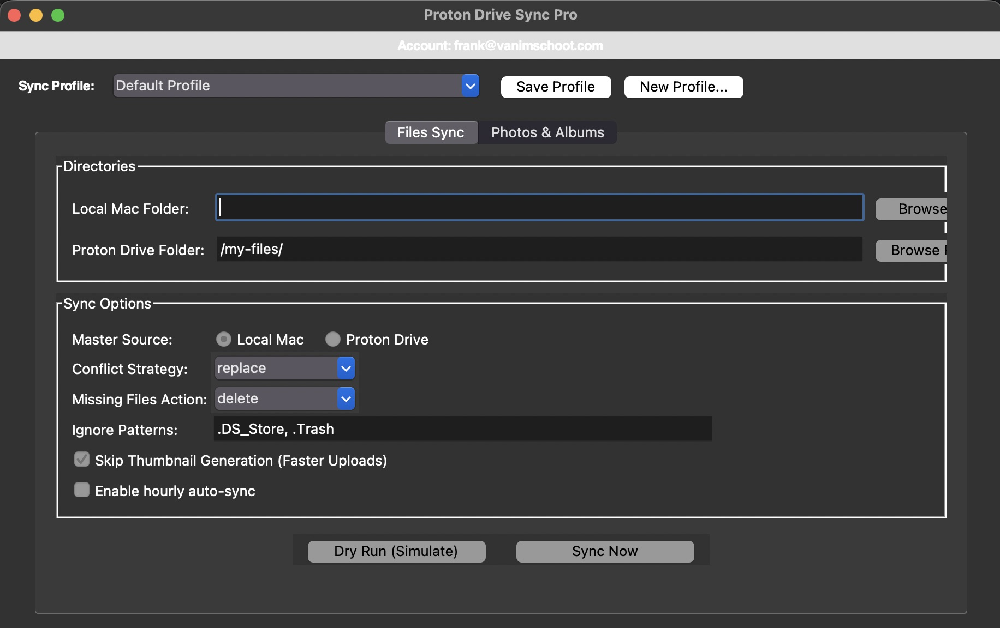
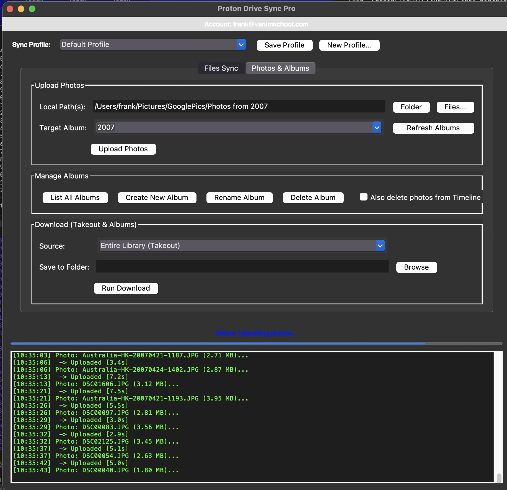

# SyncProGUI for Proton Drive ☁️
A lightweight, standalone Python/Tkinter GUI wrapper for the official [Proton Drive CLI](https://proton.me/drive). 

**Unlock Proton Photos on macOS:** Until now, uploading photos directly to your Proton Drive Photo Library and organizing them into Albums was impossible on Mac desktops. This application bridges that gap, giving you a native, rich visual interface to synchronize files, manage your photo library, and run backups without ever needing to touch the command line.

---

 

---

## ✨ Features

* **📸 First-Class macOS Photo & Album Management:** 
  * Upload single photos or bulk directories directly to your Proton Photos timeline.
  * Map uploaded photos instantly to specific Albums.
  * Download specific Albums, or run a full "Takeout" to download your entire photo library.
  * *Brings full photo-sync capability to Mac desktops!*
* **📊 Live Progress Tracking:** Custom background streaming reads the CLI byte-by-byte to provide real-time, accurate visual progress bars for your uploads and downloads.
* **🔄 Smart Files Sync:** Bi-directional syncing (Mac ↔ Proton Drive) with customizable conflict strategies, ignore lists, and missing-file handling. Automatically skips existing files to save bandwidth.
* **👤 Multi-Account Support:** Automatically detects your authenticated `@proton.me` or `@pm.me` email and allows for seamless account switching.
* **💾 Sync Profiles:** Save your frequently used remote/local path pairings and custom sync settings to load them instantly via a dropdown.

---

## 🛠 Prerequisites

1. **macOS, Linux, or Windows** (Fully cross-platform).
2. **Python 3.x** installed.
3. The official **[Proton Drive CLI](https://proton.me/support/drive-cli)** installed and configured.
   * **Mac / Linux Setup:** After downloading the CLI executable, you must grant it run permissions and move it to a system folder so the script can find it. Open your terminal and run:
     ```bash
     chmod +x /path/to/downloaded/proton-drive
     sudo mv /path/to/downloaded/proton-drive /usr/local/bin/proton-drive
     ```
   * **Authentication:** Before using this GUI for the very first time, open your terminal and run `proton-drive auth login` to link your account.

*Note: This app relies entirely on Python's built-in standard libraries (`tkinter`, `subprocess`, `json`, `threading`). No extra `pip install` commands or heavy virtual environments are required!*

---

## 🚀 How to Run

1. Clone this repository to your local machine:
   ```bash
   git clone [https://github.com/YOUR_USERNAME/SyncProGUI-for-Proton-Drive.git](https://github.com/YOUR_USERNAME/SyncProGUI-for-Proton-Drive.git)

2. Navigate into the project folder:
   ```bash
   cd SyncProGUI-for-Proton-Drive

3. Navigate into the project folder:
   ```bash
   python3 SyncProGUI.py


## 📝 License

This project is licensed under the GNU General Public License v3.0 (GPLv3).
You are free to use, modify, and distribute this software, provided that any derivative works are also open-source and licensed under the same GPLv3 terms. See the LICENSE file for more details.

## ⚖️ Disclaimer

This is an unofficial, community-built, open-source companion tool.
This project is not affiliated with, maintained, authorized, endorsed, or sponsored by Proton AG or any of its affiliates. "Proton" and "Proton Drive" are registered trademarks of Proton AG.
This software is provided "as is", without warranty of any kind. Please use it responsibly and ensure you understand the sync deletion settings before running automated backups.
